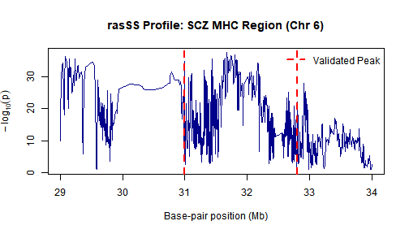

## Introduction

This vignette demonstrates the `rasSS` workflow on real GWAS summary statistics and a real 1000 Genomes LD reference panel. We analyze the Major Histocompatibility Complex (MHC) region on Chromosome 6, a well-known locus for Schizophrenia risk. 

We use the `scan_block()` function, which handles:
1. Ingesting and standardizing discovery and target summary statistics.
2. Intersecting them with a PLINK binary reference panel.
3. Extracting dosages and computing the empirical LD matrix.
4. Harmonizing alleles (flipping strands, dropping palindromic SNPs).
5. Running the summary-statistic RAS scan and calling peaks.

## Data Sources

* **Discovery GWAS**: Schizophrenia 2018 (CLOZUK + PGC)
* **Target GWAS**: Schizophrenia 2022 (PGC)
* **LD Reference**: 1000 Genomes Phase 3 EUR panel
* **Region**: Chromosome 6, 29Mb to 34Mb (MHC Class II region)

## Running the Analysis

Assuming you have the summary statistics and the PLINK reference files (`chr6_eur.bed`, `.bim`, `.fam`) in your `data/` directory, the entire pipeline is executed via a single idempotent call to `scan_block()`.


``` r
library(rasSS)

res <- scan_block(
  disc_path   = "data/sumstats/scz2018_clozuk.tsv.gz",
  targ_path   = "data/sumstats/scz2022.tsv.gz",
  chr         = 6,
  start_bp    = 29e6,
  end_bp      = 34e6,
  ref_prefix  = "data/1000G/chr6_eur",
  plink2      = "plink2", # or path to plink2 executable
  out_rds     = "data/results/blk_scz_chr6_mhc.rds",
  skip1       = 10,
  skip2       = 5,
  min_window_size = 5,
  max_window_size = 20,
  window_size = 20,
  slope_check_window_size = 8,
  slope_threshold = 1e-4,
  davies_threshold = 1e-5
)
#> [read_sumstats] read: 8064799 rows, 8 cols
#> [read_sumstats] after chr filter: 546107 
#> [read_sumstats] after bp filter: 31141 
#> [read_sumstats] final: 31141 
#> [read_sumstats] read: 7659767 rows, 8 cols
#> [read_sumstats] after chr filter: 509260 
#> [read_sumstats] after bp filter: 34434 
#> [read_sumstats] final: 34434 
#> intersect: 21816 
#> kept: 18720 of 21816
```

Because `scan_block()` is idempotent, if the `out_rds` file already exists, it will instantly load and return the cached results without re-running PLINK or the scan.

## Visualizing the RAS Profile

Let's load the cached results and plot the $-\log_{10}(p)$ Regional Association Score (RAS) profile across the MHC region.


``` r
# For demonstration purposes, we load the pre-computed .rds file 
# generated by the package verification script.
rds_path <- "data/results/blk_scz_chr6_mhc.rds"

if (file.exists(rds_path)) {
  res <- readRDS(rds_path)
  
  # Extract the scan profile and base-pair positions
  # scan$x contains the SNP indices. We map them to BP using the bp vector.
  snp_indices <- res$scan$x
  bp_positions <- res$bp[snp_indices]
  ras_scores <- res$scan$y
  
  # Plot the profile
  plot(bp_positions / 1e6, ras_scores, type = "l", lwd = 1.5, col = "darkblue",
       xlab = "Base-pair position (Mb)", 
       ylab = expression(-log[10](p)),
       main = sprintf("rasSS Profile: SCZ MHC Region (Chr %d)", res$chr))
  
  # Overlay validated peaks
  if (length(res$peaks$bp) > 0) {
    abline(v = res$peaks$bp / 1e6, col = "red", lty = 2, lwd = 2)
    legend("topright", legend = "Validated Peak", col = "red", lty = 2, lwd = 2, bty = "n")
  }
  
  cat(sprintf("Intersected SNPs: %d\n", res$n_intersect))
  cat(sprintf("Kept after harmonization: %d (%.1f%%)\n", 
              res$n_kept, 100 * res$n_kept / res$n_in))
  cat(sprintf("Validated peaks found: %d\n", length(res$peaks$bp)))
} else {
  message("RDS file not found. Please run the scan_block() chunk above first.")
}
```



```
#> Intersected SNPs: 21816
#> Kept after harmonization: 18720 (85.8%)
#> Validated peaks found: 2
```

## Interpreting the Output

The `scan_block()` function returns a list containing:
* `scan`: The RAS profile (`x` = SNP indices, `y` = $-\log_{10}(p)$).
* `peaks`: A data frame of validated changepoints mapped to SNP indices, grid indices, and exact base-pair positions.
* `bp`: The base-pair positions of all SNPs that passed harmonization.
* `n_intersect`, `n_kept`, `n_in`: Quality control metrics showing how many SNPs survived the intersection with the LD reference and the allele harmonization step.

By relying on external LD reference panels and summary statistics, `rasSS` bypasses the need for individual-level genotype data while maintaining the rigorous regional change-point detection of the original RAS algorithm.
